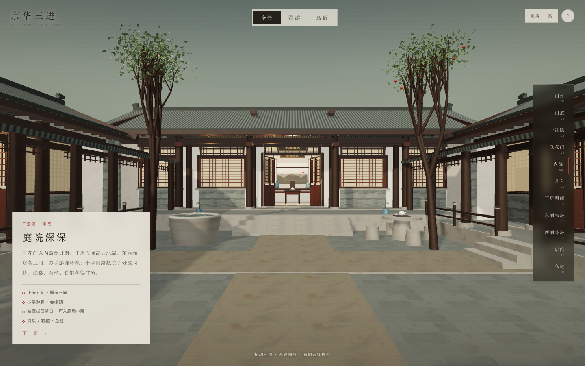
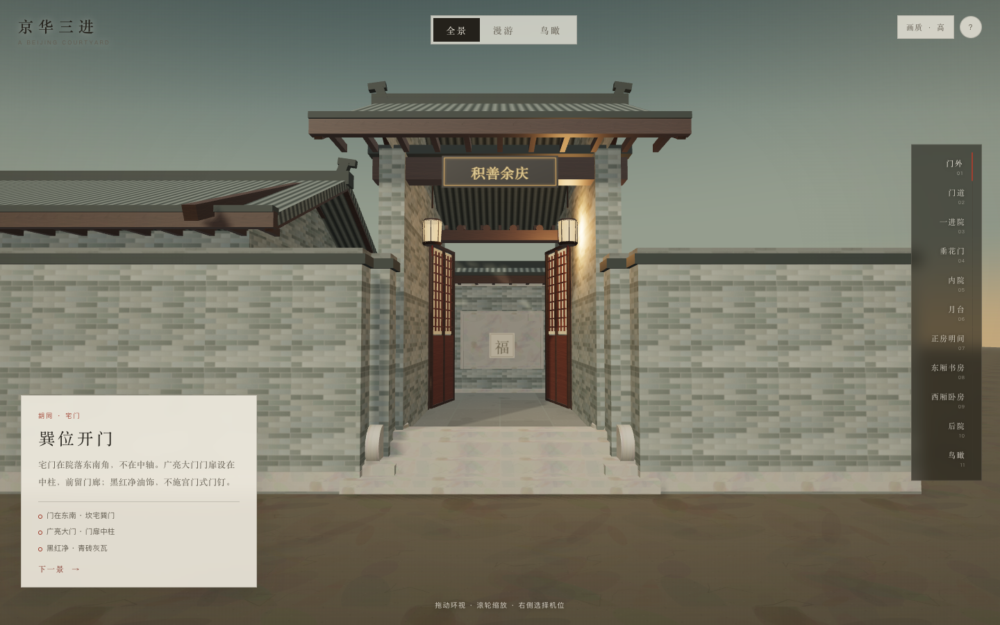
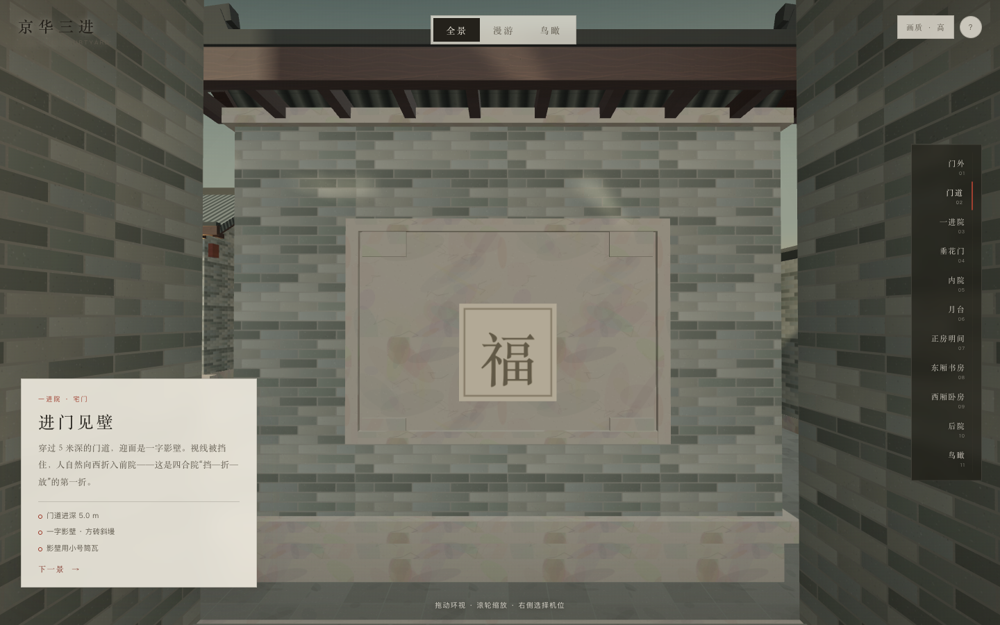
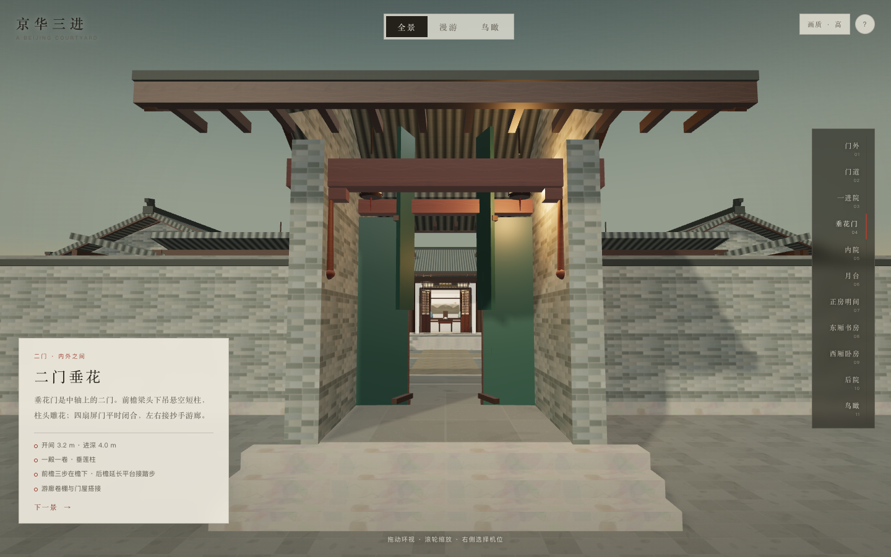
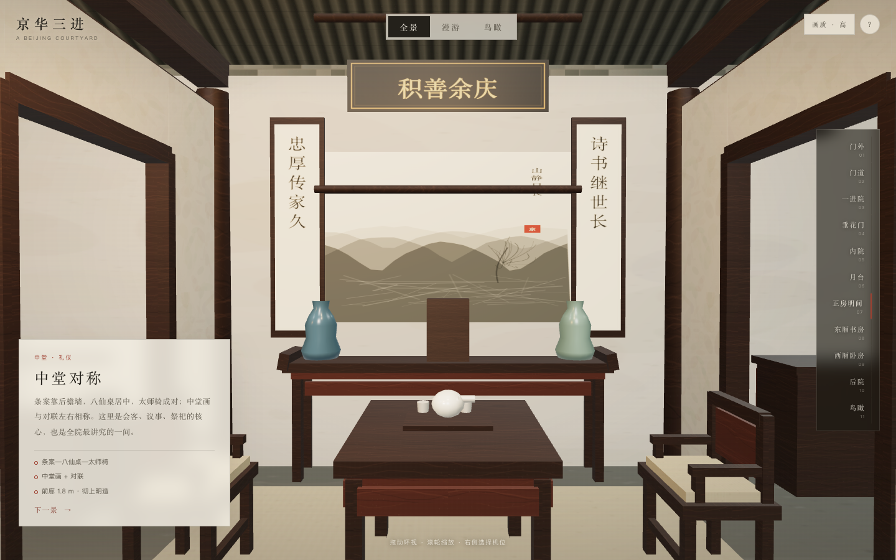
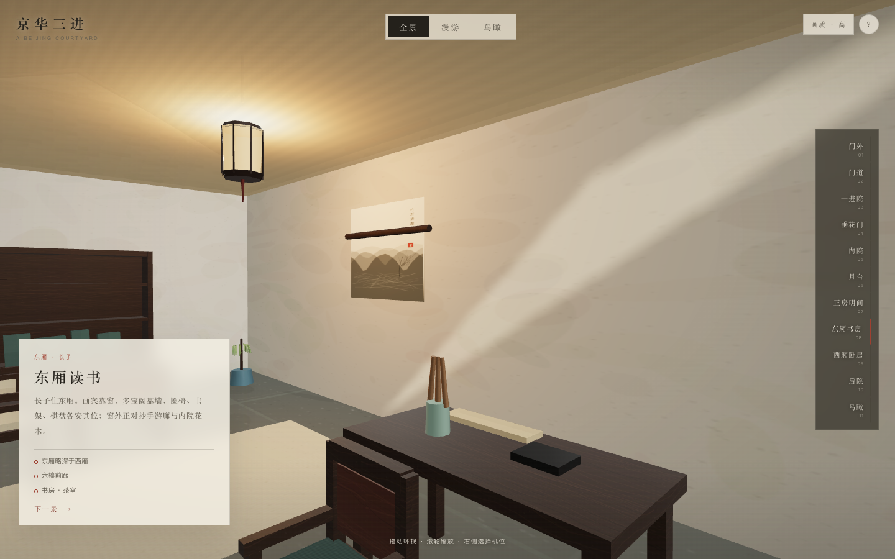
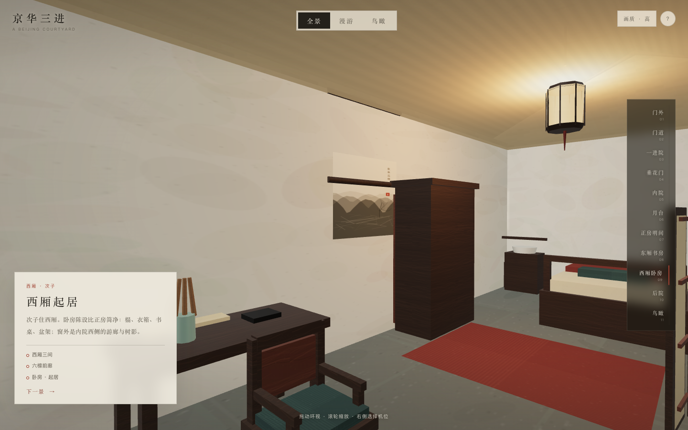
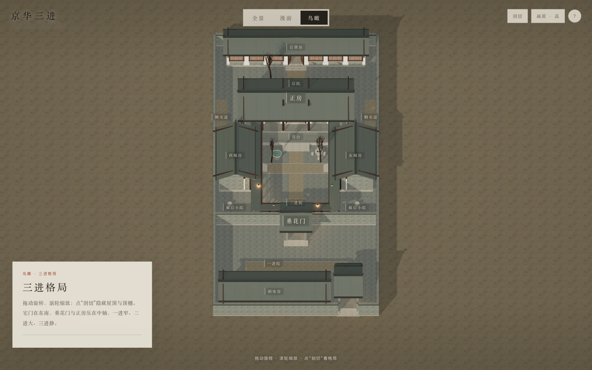
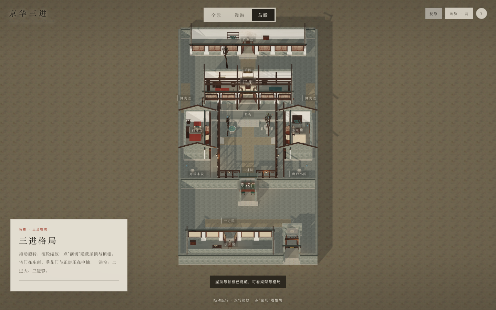

# 京华三进 · 北京三进四合院数字漫游

一个用 **three.js + TypeScript + Vite** 实时渲染的北京三进四合院。项目先完成建筑考据与设计规范，再按规范实现：青砖灰瓦、硬山合瓦、东南巽位宅门、垂花门、抄手游廊、正房五间、厢房三间、后罩房七间，以及可进入的中堂、书房、卧房。

> 本场景是**类型化复原**，不是某一座现存文保院落的测绘复刻。所有尺寸以《北京老城保护房屋修缮技术导则（2019版）》与北京四合院类型研究为基线，叠加方案设计值；详见 [建筑考据与设计规范](docs/三进四合院-建筑考据与设计规范.md)。



## 快速开始

```bash
pnpm install
pnpm dev
# 打开 http://127.0.0.1:5178/
```

生产构建：

```bash
pnpm build
pnpm preview
```

- 全部模型、纹理、家具、树木均由代码程序化生成，不依赖外部图片、模型或 CDN。
- 需要支持 WebGL2 的现代浏览器；桌面端优先，移动端可使用简化画质。

## 三种观看方式

| 模式 | 说明 |
|---|---|
| **全景** | 10 个院内外固定机位 + 鸟瞰入口，拖动 360° 环视，滚轮/双指缩放。右侧可依次切换门外、门道、一进院、垂花门、内院、月台、正房明间、东厢书房、西厢卧房、后院、鸟瞰。 |
| **漫游** | 第一人称入院进屋。WASD 行走，鼠标转向，Shift 加速，Esc 释放鼠标；移动端用左侧摇杆行走、拖动画面转向。带墙体/家具碰撞、台阶抬升、小地图。 |
| **鸟瞰** | 正交俯视，查看三进格局、建筑等级与轴线。点“剖切”隐藏屋顶和顶棚，直接看梁架与室内。 |

顶部 `1 / 2 / 3` 可快速切换模式，`?` 打开操作说明。

## 场景内容

- **宅门**：东南巽位，广亮大门，门扉中柱，黑红净油饰，门簪、抱鼓石、门槛、门道灯笼。
- **一进院**：倒座房五间、门房/账房、独立一字影壁、小高窗。
- **垂花门**：一殿一卷，垂莲柱，四扇屏门，左右接抄手游廊；檐口出挑 0.95 m，三步踏跺均在檐下，游廊卷棚与门屋搭接。
- **二进院**：正房五间、东西厢房各三间、月台、十字甬路、海棠、石榴、鱼缸、石桌。
- **正房室内**：中堂（条案、八仙桌、太师椅、中堂画、对联、匾额、座钟、掸瓶），东次间书房，西次间卧房，彻上明造梁架。
- **厢房室内**：东厢书房/茶室，西厢卧房，书案、多宝阁、榻、衣箱、盆架。
- **三进院**：后罩房七间，后墙封闭，枣树、石桌、水缸，室内简装。
- **正房月台**：13.6 × 2.2 m、0.60 m 高；前廊净深 1.8 m，总进深仍 7.2 m。月台东西接到游廊边线，游廊最后 2.2 m 抬到 0.60 m；月台两端四级侧阶下到 0.00 m 侧夹道，通后院。
- **廊后小院**：东西厢房南端与看面墙之间的采光/排水/杂物小院；游廊与垂花门同标高平接；厢房门口断开栏杆做三级下院，端部留 1.8 m 开口，可从垂花门两侧进入，不是正式房间。
- **鸟瞰剖切**：屋顶、顶棚可隐藏，保留墙体和梁架。

## 建筑要点

- 坐北朝南，中轴对称，宅门在东南角而非中轴。
- 三进序列：倒座房—垂花门—正房—后罩房。
- 正房五间、厢房三间、后罩七间；正房台基、柱高、进深均大于厢房。
- 硬山、合瓦、清水脊；主屋不用琉璃瓦/筒瓦；小式部位才用小号筒瓦。
- 青砖灰瓦，不做白墙黛瓦、马头墙。
- 大门黑红净，不做满堂朱红、宫门式门钉。
- 前院对外、内院住人、后罩最私密；垂花门为内外分界。
- 中堂条案—八仙桌—太师椅—中堂画—对联对称；不摆现代沙发电视。
- 隔扇门、支摘窗、步步锦、糊纸；室内无现代灯具/电器。
- 庭院海棠、石榴、枣树；不种松柏、杨树，不做枯山水。

## 目录

```
.
├── docs/
│   ├── 三进四合院-建筑考据与设计规范.md
│   ├── 三进四合院-总平面.svg / .png
│   ├── 三进四合院-剖面示意.svg / .png
│   └── screenshots/               # 场景截图
├── src/
│   ├── data/site.ts               # 总平面、单体、机位、房间标签
│   ├── lib/materials.ts           # 程序化砖/瓦/木/石/纸/织物/书画
│   ├── lib/geom.ts                # 世界尺度 UV、屋顶、棂条、门扇
│   ├── world/
│   │   ├── world.ts               # 场地、墙体、总装
│   │   ├── halls.ts               # 正房/厢房/倒座/后罩
│   │   ├── gate.ts                # 宅门、垂花门、影壁
│   │   ├── corridor.ts            # 抄手游廊
│   │   ├── garden.ts              # 铺地、月台、树、水缸、石桌
│   │   ├── optimize.ts            # 静态几何按材质合批
│   │   └── context.ts             # 碰撞体、地面高度区、剖切组
│   ├── interior/
│   │   ├── furniture.ts           # 家具/灯具/瓷器/书画构件
│   │   └── rooms.ts               # 五个重点房间陈设
│   ├── modes/modes.ts             # 全景 / 漫游 / 鸟瞰
│   ├── ui.ts                      # 模式、机位、信息卡、小地图
│   ├── main.ts                    # 渲染、灯光、模式调度
│   └── style.css
├── index.html
├── package.json
└── vite.config.ts
```

## 实现说明

- **程序化 PBR**：青砖、合瓦、木纹、石材、铺地、纸、织物、水墨画、书法均由 Canvas 生成颜色/凹凸/粗糙度贴图，随场景实时加载。
- **真实尺度 UV**：墙体/屋面按米制 UV 平铺，避免贴图被拉伸。
- **合批优化**：静态建筑、家具、树木枝干按材质合并，桌面端 draw call 约 380–400、三角面约 7 万；屋顶与顶棚单独保留，供剖切切换。
- **负 Z 方向校正**：平面数据以 +Z 为北，渲染时整体镜像为 three.js 的 -Z 北向，保证面向北时东侧在右；文字、匾额、对联的 U 轴已单独校正。
- **行走碰撞**：2D AABB 碰撞 + 平台/月台/游廊高度区；台阶通过相机高度平滑过渡；门洞留空，可进入重点房间。
- **无外部资产**：字体使用系统宋体/思源宋体回退，不请求 Google Fonts 或 CDN。

## 截图

| | |
|---|---|
|  |  |
|  |  |
|  |  |
|  |  |

## 已知边界

- 这是类型化复原，不是测绘工程；开间、台基、檐口、脊高为方案设计值，详见设计规范。
- 木雕、砖雕、彩画以低模 + 程序化纹理概括，未逐件复原复杂雕花。
- 门扇保持开启，方便参观；尚未实现门轴开合动画与音效。
- 家具为风格化程序化模型，重点保证类型、位置与礼制关系，不追求每件家具的文物级形制。
- 性能目标为桌面端 60fps；移动端可在右上角切换“画质 · 轻”。

## 资料

- [《北京老城保护房屋修缮技术导则（2019版）》](https://zjw.beijing.gov.cn/bjjs/resource/cms/article/300695/53604260/2019110416163591590.pdf)
- 马炳坚《北京四合院建筑》《中国古建筑木作营造技术》
- 段柄仁主编《北京四合院志》
- 北京古代建筑研究所《北京旧城建筑修缮与保护技术手册》
- 文物网《四合院的居家摆设》（生活陈设交叉参考）

完整考据、设计值与待确认记录见 [docs/三进四合院-建筑考据与设计规范.md](docs/三进四合院-建筑考据与设计规范.md)。
