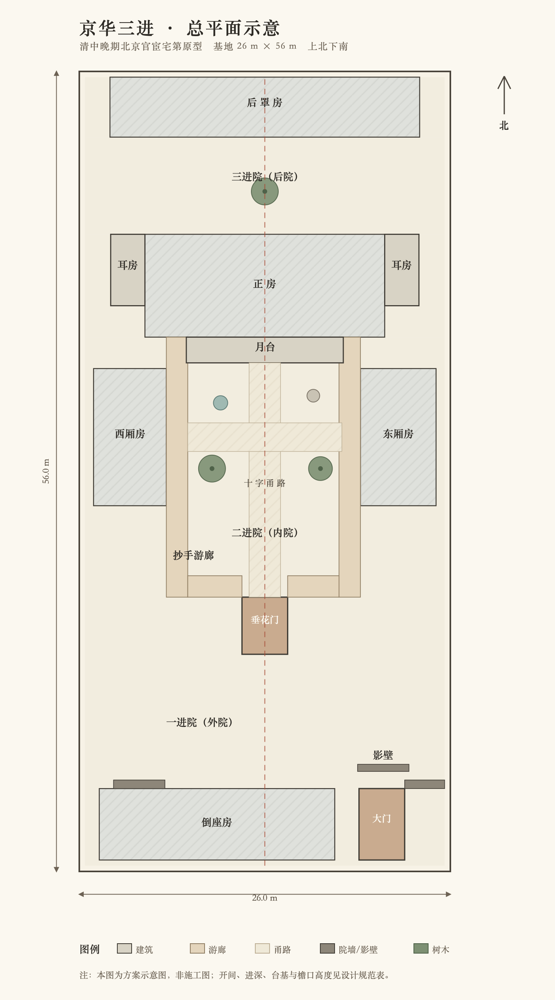
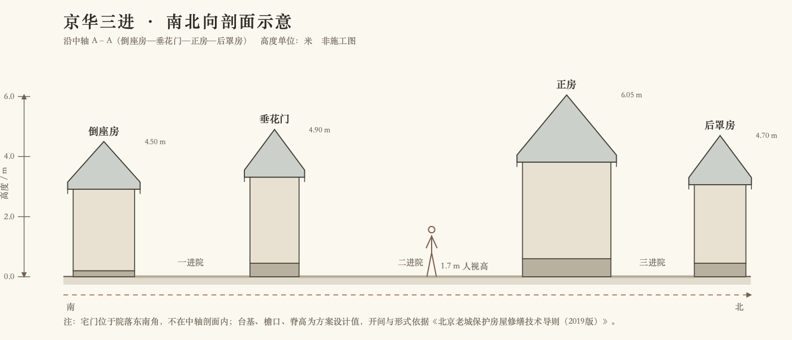

# 京华三进
## 北京三进四合院数字漫游 · 建筑考据与设计规范 v1.1

> 状态：**方案已冻结并完成首轮实现（v1.1，2026-10-17）**。本文件完成考据、定样与开发边界；对应 three.js 场景已落地。
> 目标：用 three.js 做一座可全景观看、可入院、可进屋的中式三进四合院；外观、构造、油饰、陈设均能说清依据。
> 原则：**先把“房子为什么这样建”说清楚，再决定“怎么做好看”**。凡是推演值，明确标注为“设计值”，不冒充测绘数据。

---

## 0. 证据分级与结论摘要

### 0.1 证据分级

| 级别 | 来源 | 用法 |
|---|---|---|
| A | 北京市住建委等《北京老城保护房屋修缮技术导则（2019版）》；《北京四合院志》；北京古代建筑研究所《北京旧城建筑修缮与保护技术手册》 | 格局、形式、尺度、做法、色彩、植物的硬约束 |
| B | 马炳坚《北京四合院建筑》《中国古建筑木作营造技术》；姜振鹏《传统建筑木装修》 | 大木、瓦石、装修的构造做法 |
| C | 文物网、行业设计机构整理文章 | 室内陈设、生活场景的交叉参考 |
| D | 本方案设计值 | 总体尺寸、单体组合、具体家具布置、艺术化取舍 |

> 本文把 A/B 级事实与 D 级设计值分开写。**设计值不是“历史唯一答案”**：三进院因宅主身份、地块、朝向、建造年代不同而有大量变体，本方案是“清中晚期北京官宦宅第”的一个类型化复原，不是某一座现存文保院落的测绘复刻。

### 0.2 一句话结论

采用 **清中晚期 · 北京内城 · 官宦/书香门第 · 三进四合院** 为原型：坐北朝南，宅门在东南，广亮大门，倒座房五间，垂花门为二门，内院正房五间、东西厢房各三间，后罩房七间；硬山、合瓦、清水脊、青砖灰瓦、黑红净油饰、墨线苏画；室内以中堂、书房、卧房为重点，陈设遵循中轴对称与内外有别。

### 0.3 已确认选择（2026-10-17）

| 编号 | 事项 | 已确认 |
|---|---|---|
| D1 | 原型身份 | 清中晚期·北京官宦/书香门第 |
| D2 | 画风与性能 | 写实 PBR，桌面优先 60fps |
| D3 | 室内范围 | 五个重点房间精装 + 其他可进入简装 |
| D4 | 观看模式 | 实时 3D 全景机位 + 第一人称漫游 + 鸟瞰剖切 |
| D5 | 资产策略 | 全程序化生成，离线可运行 |
| D6 | 默认氛围 | 夏末初秋午后 |
| D7 | 周边环境 | 只做院落内部 + 门内影壁 |

### 0.4 主要参考

- [《北京老城保护房屋修缮技术导则（2019版）》（北京市住房和城乡建设委员会等，公开征求意见稿）](https://zjw.beijing.gov.cn/bjjs/resource/cms/article/300695/53604260/2019110416163591590.pdf)。本文所引“宅门形式、垂花门开间、正房开间与檐柱高、墙体、屋面、油饰彩画、影壁、植物”等，主要出自该导则 PDF 第 27–35、37–49、50–68、83–96、100–106 页。
- 马炳坚《北京四合院建筑》，天津大学出版社；《中国古建筑木作营造技术》。
- 段柄仁主编《北京四合院志》，北京出版社。
- 北京古代建筑研究所《北京旧城建筑修缮与保护技术手册》。
- 文物网《四合院的居家摆设》（生活陈设参考，C 级）。
- 东方晨光《四合院中式装修设计：中堂设计的讲究》（行业整理，C 级；其中“东瓶西镜”说法需谨慎，见 §5.5）。

---

## 1. 建筑考据：十五条关键事实与本方案选型

### 1.1 坐北朝南，中轴对称，宅门在东南

北京四合院的主流朝向是坐北朝南。院落以南北中轴线组织，正房、垂花门、后罩房都在中轴上；**宅门不在中轴，而在东南角（巽位）**，即“坎宅巽门”。这是北京四合院最容易被做错的第一件事：把大门开到正中，会直接变成王府、庙宇或现代合院的逻辑。

宅门通常占据倒座房最东端的一间或半间；等级较高的广亮大门，在《导则》中也记作“位于院落东南侧的第二间位置”。本方案取**东南端一间**，门道向东侧院墙留出夹道，保证“巽位”与门楼独立台基。

### 1.2 三进的序列是“门—院—门—院—房—院—房”

标准三进院的南北序列：

1. **一进院（外院）**：倒座房、宅门、影壁、前院。对外接待、门房、账房、男仆居所。
2. **二进院（内院）**：垂花门以内，东西厢房、正房、抄手游廊。家长与未成年子女起居，是全院核心。
3. **三进院（后院）**：正房之后、后罩房之前。后罩房多为未嫁女眷、女仆、藏书与储藏，私密性最高。

《导则》原文把三进院概括为“正面临街为倒座房，宅门一般开在倒座房东南角，后为东西厢房及北侧正房，最北侧为后罩房”。这三段不是三个“院子”简单相加，而是**由外到内、由公共到私密、由低到高的等级序列**。

### 1.3 垂花门是“二门”，不是大门

垂花门位于中轴线上，是内外宅的分界，也就是俗语“大门不出、二门不迈”的“二门”。它体量不大，开间约 2.5–3.3 m，进深略大于面宽，装饰华丽；前檐挑出的梁头下吊悬空短柱，柱头雕花，故名“垂花”。

垂花门平时以屏门遮挡视线，屏门常闭，人从两侧或特定礼仪场合通行；两侧接抄手游廊，直达东西厢房与正房前檐。**把垂花门当大门、或把它做成一座独立的牌楼，都是错的。**

### 1.4 正房五间、厢房三间、后罩房七间

- 正房：三开间或五开间；规模较大的明间面阔可达 3.9–4.2 m，次间约 3.3 m，檐柱高 3.3–3.5 m。
- 厢房：以三间为主，开间与进深都小于正房；无廊进深约 4 m，带前廊可达 5 m 左右。
- 倒座房：通常五间左右，临街后檐不开大窗或只开高窗。
- 后罩房：最后一排，多五檩，一般不做外廊；本方案做七间。
- 耳房：一开间，尺度小于厢房，常作厨房、杂物、佛堂或储藏。

本方案取**正房五间、厢房三间、倒座五间、后罩七间、正耳房各一间**。这是官宦宅第的常见规格，不是最大也不是最小。

### 1.5 正房最高大，台基、柱高、进深都要压过厢房

《导则》用“出入躲闪、高低错落”概括四合院的平立面关系：

- 平面上，正房开间、进深大于厢房；东厢房进深略大于西厢房。
- 立面上，正房台基高于厢房，柱高略大于厢房。
- 耳房又小于厢房，前檐向后退，给抄手游廊留出空间。
- 垂花门开间、进深大于两侧游廊，以显其重要。
- 宅门进深往往大于倒座房，处在突出位置。

所以不能把五座房子做成同一高度、同一进深，否则院子会“平掉”，失去北京四合院的等级秩序。

### 1.6 硬山、合瓦、清水脊；主屋不用琉璃瓦

北京民居四合院以**硬山顶**为主，屋面以**合瓦（阴阳瓦）**为主，正脊常用**清水脊**，两端做“蝎子尾”；也可做过垄脊、鞍子脊。正房、厢房、倒座、后罩的屋面不做庑殿、歇山，也不做南方飞檐翘角。

《导则》明确：普通民居四合院屋面不用筒瓦；筒瓦只用于影壁、小型门楼、看面墙、廊子、垂花门等小式部位，且限 10 号筒瓦。**主屋用琉璃瓦、筒瓦，或把屋顶做成“王府大殿”，都是等级错误。**

### 1.7 青砖灰瓦，不是白墙黛瓦

北京四合院是**青砖灰瓦**：青灰色砖墙、灰黑色合瓦、石材台明与阶条。白墙黛瓦是江南/徽派印象，不是北京胡同四合院的标准色彩。软心墙可以抹灰呈月白色，但整体仍应保持青砖灰瓦的灰度。

### 1.8 大门是“黑红净”，不是满堂朱红

《导则》对民居油饰说得很清楚：大门一般采用**黑红净**——柱、槛、框、门扇、对联雕刻的字用黑油，对联地子和余塞用土红；也可用土红油、土黄油、透木纹硬木色。**“民居一律刷红色，尤其朱红色”被明确列为违背传统风貌的做法。**

本方案的红色只做点色：春联、灯彩、坐垫、部分内檐小木作；大门、檐柱、槛框以黑褐、硬木色、土红为主。这样比“红墙金瓦”更像北京，也更耐看。

### 1.9 内外有别：前院对外，内院住人，后罩最私密

- 男仆不能进内宅，住外院倒座房。
- 家长住正房；大儿子住东厢，小儿子住西厢；未嫁女子由女仆陪伴住后罩房。
- 垂花门是这条界线：门外是接待、账房、门房；门内是家眷日常。
- 后罩房临胡同的后墙通常封闭，不开大门，也不做面向胡同的大窗。

这条生活逻辑会直接决定房间功能、家具密度和门禁/导览文案。漫游时可以让游客自由穿行，但信息卡要说明“这里原本谁能进”。

### 1.10 中堂是正房明间的核心，对称是硬规矩

正房明间为厅堂/中堂，承担会客、议事、礼仪、祭祖等功能。核心陈设：

- 后檐墙正中靠墙：**条案**（翘头案/平头案）。
- 条案前：**八仙桌**。
- 八仙桌两侧：成对**太师椅/扶手椅**。
- 墙上：**中堂画**（山水、花鸟、书法或祖先像）+ 左右**对联**。
- 条案上：座钟、掸瓶、帽筒、盆景、瓷器等，左右成组。
- 两侧可再设座椅、茶几、花几，形成“一堂四椅”或更完整的会客格局。

对称不是“看起来整齐”，而是尊卑、主客、内外秩序的空间化。不要把中堂做成现代客厅：沙发、电视、大茶几、吊灯都不属于这个场景。

### 1.11 外檐装修：隔扇门、支摘窗、步步锦、糊纸

- 正房、厢房明间：四扇**隔扇门**，一般左右两扇固定，中间两扇向内开启；上部棂格、下部裙板。
- 次间、梢间：**支摘窗**，每间上下左右四扇，上扇可支起，下扇可摘下；窗棂常用步步锦、灯笼框、冰裂纹、盘长等。
- 槛墙高度约 3/10 檐柱高；窗下设榻板。
- 窗纸糊高丽纸/白纸，白天透光，形成柔和的室内光。
- 倒座房临街后檐做高窗，兼顾采光与安全；后罩房后墙封闭。

本方案把“步步锦”作为主纹样，局部用灯笼框、冰裂纹；棂条按约 19 mm 看面、25 mm 进深、净空 60–70 mm 的比例做，近看才经得起。

### 1.12 影壁：进门迎面，挡视线，不挡路

宅门内迎面设影壁，可独立建造（一字影壁），也可借东厢房南山墙（坐山影壁）。影壁由下碱、壁心、瓦顶组成；壁心可方砖斜墁、素作或雕花，中心花、岔角花；屋面用小号筒瓦，不能用合瓦。

本方案在门内 1.4 m 处设独立一字影壁，宽 3.6 m、厚 0.5 m、高 3.1 m，青砖须弥座，壁心方砖斜墁，中心与四角做浅浮雕。它既符合“进门不见院”的视线控制，也给门道一个对景。

### 1.13 抄手游廊：连接垂花门、厢房、正房

抄手游廊从垂花门两侧出发，沿内院东西两侧，经过厢房前檐，直达正房前檐，形成“抄手”状环抱。廊子一般卷棚顶，柱间设坐凳栏杆、倒挂楣子；廊心墙下碱干摆、上身丝缝或抹灰软心。

它不只是通道，也是内院的边界：廊子把大院子“收”成有层次的室内外过渡，雨天不湿鞋，夏天有阴凉。没有游廊，内院会显得空、散、平。

### 1.14 庭院植物：海棠、丁香、石榴、枣树；松柏杨不宜

《导则》列出的庭院树种包括海棠、丁香、石榴、榆叶梅、玉兰、枣树、槐树等；松柏、杨树不宜种在四合院里。旧时还有“桑松柏梨槐，不进府王宅”一类讲究，属于民俗层面，可作为氛围参考，不必当成绝对禁令。

本方案内院以**海棠 + 石榴**为主景，后院点一棵**枣树**；不种松柏、杨树，也不做日式枯山水、欧式草坪。

### 1.15 一张“常见错误”对照表

| 常见错误 | 为什么错 | 正确做法 |
|---|---|---|
| 大门开在中轴 | 那是王府/庙宇/合院逻辑 | 宅门在东南角，中轴让给垂花门、正房 |
| 主屋用琉璃瓦/筒瓦 | 民居等级不够 | 合瓦、清水脊；小式部位才用 10 号筒瓦 |
| 白墙黛瓦、马头墙 | 江南/徽派语汇 | 青砖灰瓦，硬山，平缓屋面 |
| 满堂朱红、金碧辉煌 | 民居油饰以黑红净、土红、硬木色为主 | 红色只做点色，木色为主 |
| 正房和厢房一样高 | 失去“高低错落” | 正房台基、柱高、进深最大 |
| 垂花门当大门 | 垂花门是二门 | 大门在东南，垂花门在内院入口 |
| 后罩房开大门/大窗 | 后罩房临胡同，私密性最高 | 后墙封闭，门开向院内 |
| 中堂摆沙发电视 | 时代与礼制错位 | 条案、八仙桌、太师椅、中堂画 |
| 满院红灯笼 | 民俗主题公园化 | 宫灯/廊灯适度，白天以自然光为主 |
| 龙纹、黄色琉璃、脊兽 | 民居禁用/等级僭越 | 花卉、博古、山水、福寿纹 |
| 松柏杨树、枯山水 | 不是北京四合院典型 | 海棠、石榴、丁香、枣树 |

---

## 2. 设计原型与总体尺度

### 2.1 选定原型

| 项 | 选择 | 理由 |
|---|---|---|
| 时代 | 清中晚期 | 现存北京四合院做法最成熟、资料最充分；油饰彩画、砖木装修可考 |
| 地域 | 北京内城胡同 | 硬山、合瓦、青砖、广亮大门的地域语汇 |
| 宅主 | 官宦/书香门第 | 可用广亮大门、五间正房、墨线苏画；又不到王府级别 |
| 规模 | 三进，无跨院、无花园 | 满足“三进”要求，控制场景与性能边界 |
| 宅门 | 广亮大门 | 等级最高，门道深，形象明确 |
| 正房 | 五间，七檩带前廊 | 官宦宅第常见；中堂 + 书房 + 卧房都能展开 |
| 厢房 | 三间，六檩前廊；东厢略深于西厢 | 符合“东厢进深略大”的细节 |
| 后罩 | 七间，五檩无廊 | 最后一进，私密、朴素 |
| 彩画 | 墨线苏画为主，局部金线 | 官宦宅第可用，但不做王府金龙和玺 |

**不做**：王府、皇宫、寺庙、江南园林、晋商大院、徽派天井、日式庭院、现代新中式。它们会把北京四合院的类型特征冲淡。

### 2.2 基地与坐标

- 基地：**26.0 m（东西）× 56.0 m（南北）**，墙内面积约 **1,456 m²**。
- 坐标：`+X` 向东，`+Z` 向北，`+Y` 向上；1 个 three.js 单位 = 1 m。
- 院内地面标高：`±0.000`；胡同地面约 `-0.30 m`。
- 南边界 `z = 0`，北边界 `z = 56`；中轴 `x = 13`。

> 这个 26 × 56 m 是**设计值**，不是《导则》规定的唯一尺寸。它保证：正房五间能放下、内院有足够进深、三进序列清晰、汽车/消防/漫游 collision 不至于过窄。

### 2.3 总平面



*图 1　总平面示意：上北下南。宅门在东南，影壁迎门；垂花门居中；正房五间，厢房三间，后罩七间；抄手游廊环抱内院。*

### 2.4 单体尺度表（设计值）

| 单体 | 开间 | 通面阔 | 进深 | 台基高 | 檐口高 | 脊高 | 屋顶/构架 |
|---|---|---:|---:|---:|---:|---:|---|
| 宅门（广亮） | 1 | 3.2 m | 5.0 m | 0.45 m | 4.25 m | 5.90 m | 硬山，五檩中柱 |
| 倒座房 | 5 | 16.5 m | 5.0 m | 0.20 m | 3.15 m | 4.50 m | 硬山，五檩无廊 |
| 一字影壁 | — | 3.6 m | 0.50 m | 0.30 m | — | 3.10 m | 小号筒瓦，硬山/过垄脊 |
| 垂花门 | 1 | 3.2 m | 4.0 m | 0.45 m | 3.55 m | 4.90 m | 一殿一卷，五檩 |
| 正房 | 5 | 16.8 m | 7.2 m | 0.60 m | 4.05 m | 6.05 m | 硬山，七檩带前廊 |
| 厢房（西） | 3 | 9.6 m | 5.1 m | 0.45 m | 3.55 m | 5.00 m | 硬山，六檩前廊 |
| 厢房（东） | 3 | 9.6 m | 5.3 m | 0.45 m | 3.55 m | 5.00 m | 硬山，六檩前廊 |
| 正耳房（各） | 1 | 2.4 m | 5.0 m | 0.20 m | 3.15 m | 4.25 m | 硬山，五檩 |
| 后罩房 | 7 | 21.7 m | 4.2 m | 0.45 m | 3.30 m | 4.70 m | 硬山，五檩无廊 |
| 抄手游廊 | — | 宽 1.5 m | — | 0.45 m | 2.80–3.15 m | — | 卷棚，单坡 |
| 院墙 | — | 厚 0.40 m | — | — | 高 2.60 m | — | 青砖，蓑衣顶/花瓦顶 |

开间细分：

- 正房：明间 4.0 m + 次间 3.3 m × 2 + 梢间 3.1 m × 2 = **16.8 m**。
- 厢房：明间 3.3 m + 次间 3.15 m × 2 = **9.6 m**。
- 倒座：5 × 3.3 m = **16.5 m**。
- 后罩：7 × 3.1 m = **21.7 m**。
- 耳房：各 2.4 m；正房两侧留 2.2 m 夹道至院墙。

### 2.5 南北向剖面



*图 2　沿中轴 A–A 的剖面示意：倒座房—一进院—垂花门—二进院—正房—三进院—后罩房。宅门在东南，不在本剖面内。*

剖面要点：

- 一进院进深约 9.4 m，二进院约 18.2 m，三进院约 6.8 m；**二进院最大、最舒展**，符合“内院为核心”的等级。
- 正房台基 0.60 m，四步踏跺；垂花门、大门、后罩 0.45 m；厢房 0.45 m；倒座 0.20 m。
- 本方案为了让“垂花门—抄手游廊—厢房”形成**同标高平接**，将游廊与厢房台基统一为 0.45 m；这比《导则》一般“厢房 1–2 阶”略高，是为连续廊路做的设计取舍。正房仍以 0.60 m 最高，倒座 0.20 m 最低。台阶只设在外侧下院与正房门槛处。
- 院外胡同比院内低约 0.30 m，入院上一级台阶，形成“内外高差”。
- 屋面坡度约 27°（设计值），北京民居屋面整体平缓，不做南方高举架、翘角。

### 2.6 空间序列与视线

1. **胡同**：只看见宅门、门楼、门墩、院墙，看不见院内。
2. **门道**：进深 5 m，门扉在中柱；迎面是影壁，视线被挡住。
3. **一进院**：从影壁西侧折入，院子窄长，倒座房一排；北面是垂花门与看面墙。
4. **垂花门**：抬头见垂莲柱、彩画、屏门；门内视线仍被屏门遮挡。
5. **二进院**：过屏门后豁然开朗，正房高居北端，东西厢房与抄手游廊形成环抱；海棠、石榴、鱼缸、石桌在十字甬路四角。
6. **正房**：上月台、进中堂，条案—八仙桌—太师椅形成第二道轴线；东次间书房、西次间卧房。
7. **三进院**：穿过正房耳房夹道或正房后檐门，进入更安静的后院；后罩房一排，枣树一棵。

这条序列的核心是**“挡—折—放—收—升”**：影壁挡、门道折、内院放、正房收、台基升。做 three.js 漫游时，镜头高度、门洞宽度、光线明暗都应服务这个节奏。

### 2.7 排水与铺地

- 不做徽派天井式的“四水归堂”空间。北京四合院以散水、排水沟、渗井组织雨水，院内地坪略高于院外，防止倒灌。
- 甬路：中轴主甬路宽 2.2 m，十字横甬路宽 2.0 m；方砖十字纹铺墁。
- 散水：沿房屋台基外侧 0.6 m，条砖一顺出或人字纹。
- 庭院其余部分海墁青砖，砖缝错缝；局部花池用砖砌池壁。
- 不做大面积抛光石材、防腐木地台、现代汀步。

---

## 3. 单体建筑做法

### 3.1 宅门（广亮大门）

- 位置：倒座房东南端，面阔 3.2 m，进深 5.0 m；门扉设在中柱，前部形成较宽门廊，故名“广亮”。
- 台基：独立台基 0.45 m，三步踏跺；门前有抱鼓石一对、上马石（可简化）。
- 门扇：2.4 m 宽 × 3.0 m 高，双扇；黑红净，门扇黑油，余塞土红，门簪青地；不施门钉（民居大门通常不用宫门式门钉）。
- 门簪：四枚，刻“吉祥”“如意”一类；门钹、门槛、门枕石齐全。
- 屋面：硬山，清水脊，合瓦；檐口略高于倒座，脊高 5.90 m。
- 门内：迎面一字影壁；门道两侧可设门房凳。
- 门前：胡同界面，不做现代防盗门、卷帘门、玻璃门。

### 3.2 倒座房

- 后墙与南院墙贴砌，之间不留可进入的窄缝；倒座房后墙直接作为临街界面。
- 东西厢房山墙与院墙之间保留约 0.6 m 石铺散水，仅用于排水/屋檐滴水，不做通行；模型中以碰撞封闭。

- 五间，通面阔 16.5 m，进深 5.0 m；台基 0.20 m，五檩无廊。
- 后檐临街：封护檐，砖檐做三层/冰盘檐；只开小高窗，不开大窗。
- 前檐朝院：支摘窗；明间可做门连窗或夹门窗，作为门房/账房入口。
- 功能：东端靠近大门为门房；向西依次账房、客房、男仆居所。
- 室内：白灰墙、青砖地、纸顶棚；账房设账桌、算盘、文房、钱柜；门房设条凳、灯笼、茶壶。陈设比内院朴素。

### 3.3 一字影壁

- 位置：门内 1.4 m，正对门道；独立建造，宽 3.6 m、厚 0.45 m、高 3.1 m。
- 构成：下碱（须弥座/砖砌）、壁心、上枋、瓦顶。
- 壁心：方砖斜墁，中心花 + 四角岔角花，浅浮雕；不做彩绘大壁画。
- 瓦顶：小号筒瓦，硬山或过垄脊；不能用合瓦。
- 作用：挡视线、聚气、对景；不是照壁式现代景墙。

### 3.4 垂花门

- 位置：中轴 `x = 13`，`z = 15.2–19.2`；面阔 3.2 m，进深 4.0 m；台基 0.45 m。
- 形式：一殿一卷（前为殿式硬山，后为卷棚），勾连搭；五檩。
- 前檐：两根垂莲柱悬空不落地，柱头雕莲花/风摆柳；檐下额枋、雀替、花板。
- 屏门：四扇，绿色油饰为主，平时闭合；中间两扇可开。屏门上方可挂匾。
- 彩画：墨线苏画，局部金线；题材花卉、博古、山水、福寿；禁用龙纹。
- 两侧：看面墙 + 抄手游廊；墙高 2.6 m，青砖丝缝，墙帽小瓦。
- 檐口与踏跺：垂花门檐口出挑 0.95 m；前檐三步踏跺进深 0.28 m 落在檐下。后檐向北延长 1.2 m 平台，与两侧游廊同标高平接；三步踏跺从平台外缘再下院，不在游廊上设台阶。南段游廊卷棚与门屋屋面搭接，转角不露天。
- 门槛：可拆卸高门槛；漫游时可做“跨门槛”镜头微升，不要直接穿模。

### 3.5 廊后小院
- 位置：东西厢房南端与看面墙之间，被抄手游廊的南端转角围合出的两块狭长小院，约 5.7 × 6.4 m。
- 性质：不是正房、厢房一类的正式房间，而是“出入躲闪”与游廊转角共同形成的**采光、通风、排水、堆物**余量空间；旧时也可作花盆、水缸、杂物的存放处，或隔出小杂屋。
- 通行：游廊坐凳栏杆在垂花门一侧留出 1.8 m 开口，可从垂花门两侧直接进入；不应做成全封闭死院。
- 本方案陈设：水缸、排水石篦、盆栽；不设正式家具，避免误读为居室。

### 3.6 抄手游廊

- 位置：内院东西两侧，西廊 `x = 6.1–7.6`，东廊 `x = 18.2–19.7`；从垂花门两侧折向北，直至正房前檐。
- 尺度：净宽约 1.5 m；台基 0.45 m；檐口 2.80–3.15 m；卷棚顶，单坡；与垂花门 .45 m 台明平接，南端石压边、不设台阶。
- 构造：檐柱、抱头梁、檩、椽、望板、灰背、合瓦；柱间坐凳栏杆、倒挂楣子；廊心墙下碱干摆、上身丝缝。
- 细节：廊下可挂六角宫灯；坐凳面用硬木色；栏杆高度约 0.45 m，可坐。
- 作用：连通垂花门—厢房—正房；雨天不湿鞋；形成内院边界。

### 3.7 正房

- 五间，通面阔 16.8 m，进深 7.2 m；台基 0.60 m，四步踏跺；七檩带前廊（后檐封护）。
- 前廊：净深 1.8 m（总进深保持 7.2 m，室内净深 5.4 m），檐柱高 3.45 m；廊下可设一对宫灯、盆景。
- 屋面：硬山，清水脊，合瓦；脊高 6.05 m；山墙做墀头、博缝、戗檐。
- 前檐：明间四扇五抹隔扇门；次间、梢间支摘窗；窗台高约 1.0 m；檐下挂匾。
- 明间：中堂；彻上明造，露七檩梁架，墨线苏画；地面方砖。
- 东次间：书房；西次间：卧房；东梢间：佛堂/静室；西梢间：储藏/侍女值房。后两间可做半开放或门扇遮挡，控制建模量。
- 月台：宽 13.6 m、深 2.2 m、高 0.60 m；南沿四步踏跺；东西两端与抄手游廊边线对齐，平台直接接到游廊端部。正房前廊 1.8 m 与月台同标高；游廊最后 2.2 m 由 0.45 m 抬到 0.60 m，在厢房北端做一级 0.15 m 石踏步，坐凳栏杆到月台边停止。月台东西两端各做四级 0.15 m 侧阶下到 0.00 m 夹道；月台两侧可放石榴盆景，但不得占用廊口和侧阶。

### 3.8 厢房

- 各三间，通面阔 9.6 m；西厢进深 5.1 m，东厢 5.3 m；台基 0.45 m，六檩前廊。
- 前廊深 1.2 m；檐柱高 3.25 m；屋面硬山、合瓦、清水脊，脊高 5.00 m。
- 西厢：次子卧房 + 书桌；东厢：长子书房 + 茶室。
- 明间隔扇门，次间支摘窗；窗棂步步锦；廊下与抄手游廊相接。
- 东厢略深 0.2 m，是《导则》“东厢进深略大于西厢”的细节；漫游时几乎察觉不到，但平面数据要保留。

### 3.9 耳房

- 正房两侧各一间，面阔 2.4 m，进深 5.0 m；台基 0.20 m；五檩；脊高 4.25 m。
- 前檐比正房后退，给游廊和排水留空间；屋面低于正房。
- 功能：西耳房茶房/厨房，东耳房佛堂/储物；只做简装，门可半开。
- 正房前廊两端外扩平台与侧阶占用的位置，在耳房前檐以南；不改变耳房开间与进深。
- 厢房南侧可设厢耳房（平顶），本方案为控制规模，暂不展开。

### 3.10 后罩房

- 七间，通面阔 21.7 m，进深 4.2 m；台基 0.45 m，五檩无廊；脊高 4.70 m。
- 后墙临胡同：封闭，不开门、不开大窗；仅做高窗/通风口。
- 前檐朝后院：支摘窗；明间设门。
- 功能：东侧藏书/账册，西侧未嫁女眷起居，中间可设祖堂/储藏。
- 后院：枣树一棵、石桌石凳、水缸；比内院更素净。

### 3.11 院墙、看面墙、散水

- 院墙高 2.6 m，厚 0.40 m，青砖丝缝/淌白；墙帽做蓑衣顶或花瓦顶，不用现代压顶。
- 看面墙：垂花门两侧，高 2.6 m，青砖，墙帽小瓦；可做砖雕岔角。
- 散水：宽 0.6 m，条砖一顺出；与台基、甬路交接处做排水沟。
- 墙根不做白色踢脚线、不做现代涂料。

---

## 4. 材料、色彩与质感

### 4.1 主色板

| 部位 | 颜色 | 参考色值 | 质感 |
|---|---|---|---|
| 青砖 | 青灰 | `#6F746F` / `#7C817B` / `#626762` | 哑光，砖缝灰浆，轻微碱蚀 |
| 合瓦 | 深灰 | `#4B504D` / `#5C615D` | 哑光，瓦垄起伏，檐口滴水 |
| 石材 | 灰米 | `#9B978B` / `#7D7A70` | 粗糙，手工凿痕 |
| 木作（深） | 黑褐 | `#2F2722` | 黑红净/黑油，微反光 |
| 木作（硬木） | 红褐 | `#5A3A2B` / `#6E3B2C` | 烫蜡，木纹可见 |
| 土红 | 氧化铁红 | `#9A4A34` | 哑光，用于余塞、对联地子 |
| 朱砂（点色） | 朱红 | `#A63C2A` | 少量，春联、坐垫、灯彩 |
| 青绿彩画 | 石青/石绿 | `#2D4D5C` / `#3F6B52` | 矿物色，低饱和 |
| 金 | 旧金 | `#B08A45` | 局部，不镜面 |
| 白灰 | 月白 | `#D8D3C5` | 抹灰，室内墙面 |
| 纸 | 米白 | `#E9E0CB` | 窗纸/顶棚，柔光 |
| 室内地面 | 青灰 | `#787A73` | 方砖，微磨光 |
| 炕席 | 草黄 | `#B99B6B` | 编织纹 |

原则：**灰色打底，木色承重，红色点睛，金色克制**。不用高饱和皇家黄、亮蓝、翠绿。

### 4.2 材质实现原则（为后续 three.js 定规矩）

- 所有材质走 PBR：`MeshStandardMaterial` 为主，玻璃/纸/薄纱少量用 `MeshPhysicalMaterial`。
- 砖、瓦、石、木、纸、布全部用**程序化 CanvasTexture** 生成：颜色图 + 粗糙度图 + 法线/凹凸；不依赖外部图片，保证离线可运行。
- 纹理尺度按真实尺寸：青砖约 240 × 115 mm，瓦垄约 180 mm，方砖约 500 mm；UV 以米为单位，避免“贴图过大/过小”。
- 做旧要克制：砖面轻微色差、瓦面雨水痕、石阶磨损、木器包浆；不做均匀脏污、不做大面积锈迹。
- 木纹方向必须顺着构件：柱竖向、梁横向、隔扇竖框竖向、裙板横向。
- 纸窗用半透材质，背后有暖光时透出柔和亮度；不要做成完全不透的白板。
- 彩画用程序化图案 + 手绘式笔触，不做照片贴图；龙纹禁用。

### 4.3 光

- 默认：夏末初秋午后，太阳高度角约 35–45°，色温约 5200–5600 K；天空光偏冷，室内灯笼 2700 K。
- 主光：一盏 DirectionalLight 做太阳，阴影贴图 2048；室内用暖色 PointLight，不喧宾夺主。
- 环境：HemisphereLight + 程序化环境贴图（RoomEnvironment 或自制灰天），让青砖、木器有柔和反射。
- 不使用“满屏金色体积光”“赛博夜景”“霓虹灯笼”。夜景模式可后置，作为可选氛围，不作为默认。

---

## 5. 装饰与室内陈设

### 5.1 外檐装饰清单

- 门：门簪、抱鼓石、门钹、门槛、门枕石、门联（可做黑底红字/红底黑字，按大门油饰搭配）。
- 墙：墀头、博缝、戗檐、砖檐、廊心墙、看面墙。
- 屋面：清水脊、蝎子尾、排山勾滴、瓦当、滴水、博缝板。
- 木：檐枋、垫板、檩头、椽头、雀替、花板、倒挂楣子、坐凳栏杆、花牙子。
- 彩画：箍头、包袱、枋心；墨线苏画为主，局部金线；题材花卉、博古、山水、福寿。
- 灯：廊下六角宫灯、门道灯笼；白天不点亮，傍晚暖光。

### 5.2 内檐装修

- 隔扇：五抹隔扇，上部棂格、中部绦环板、下部裙板；裙板浅浮雕花卉/博古。
- 花罩：落地罩、飞罩、栏杆罩；用于正房次间与梢间之间，不做整面实墙。
- 碧纱橱：可做正房卧室与次间之间的轻隔断，糊纱/玻璃；本方案用木隔扇 + 纱。
- 博古架：书房与明间之间可做一段，非满墙。
- 顶棚：正房明间彻上明造；次间/梢间纸顶棚；厢房纸顶棚。
- 地面：方砖细墁；卧室炕前可铺小地毯。
- 墙面：白灰抹面，挂字画；不贴现代壁纸。

### 5.3 正房明间：中堂

布局（以坐北朝南、面阔 4.0 m 明间为例）：

```
                后檐墙
        ┌──────────────────┐
        │   中堂画 + 对联   │
        │  ┌────────────┐  │
        │  │   条案      │  │
        │  └────────────┘  │
        │  ┌────────────┐  │
        │  │  八仙桌     │  │
        │  └────────────┘  │
        │ 椅              椅 │
        │                   │
        │   两侧花几/座椅    │
        └──────────────────┘
                前檐
```

- 条案靠后檐墙，案上：中间座钟，左右掸瓶/帽筒/盆景；成组对称。
- 八仙桌居中，桌面上茶盘、茶壶、茶碗；不摆现代玻璃杯。
- 太师椅两把，分列八仙桌左右；座序按主客/长幼，不随意斜放。
- 墙上中堂画：水墨山水或花鸟；对联内容用“忠厚传家久，诗书继世长”一类通用联，避免具体历史人物。
- 匾额：可选“积善余庆”“忠厚传家”；字用黑漆/金，尺度克制。
- 两侧：花几、盆景、宫灯；不摆电视、音响、现代沙发。

### 5.4 正房东次间：书房

- 画案靠窗，面向庭院；案上文房四宝、笔架、砚台、镇纸、卷轴。
- 多宝阁靠东墙/北墙，摆瓷器、铜器、书册、石玩；格内不过度堆满。
- 圈椅/官帽椅两把，小茶几；可设棋盘。
- 书架/书柜靠墙；线装书、函套、卷轴。
- 香炉/香几；窗前可放兰草/菖蒲。
- 墙面挂山水/书法；不挂现代海报。

### 5.5 正房西次间：卧房

- 南炕（设计选择，非唯一制度）：靠南窗，炕上设炕桌、炕柜、被褥、引枕；炕沿木作硬木色。
- 炕前设脚踏；炕侧设妆奁/铜镜/衣箱。
- 窗为支摘窗，糊纸，白天透柔光；炕上可挂幔帐。
- 地面方砖，局部小地毯；墙角设灯架/油灯。
- 不摆现代床、衣柜、空调。

> 关于“东瓶西镜”：这是徽州/江南民居常见的条案陈设说法，常被旅游文章套到北京四合院。北京中堂更常见的是座钟、掸瓶、帽筒、盆景的组合。本方案不把“东瓶西镜”当硬规矩，只把它作为可选的吉祥陈设母题。

### 5.6 厢房、倒座、后罩

| 房间 | 功能 | 关键陈设 | 建模深度 |
|---|---|---|---|
| 东厢明间 | 长子书房/茶室 | 书案、圈椅、茶桌、多宝阁、字画 | 精装，可进入 |
| 东厢次间 | 读书/休憩 | 榻、书架、棋盘 | 简装，可进入 |
| 西厢明间 | 次子卧房 | 榻/炕、衣箱、书桌 | 精装，可进入 |
| 西厢次间 | 起居/女红 | 绣架、柜、盆架 | 简装，可进入 |
| 倒座东端 | 门房 | 条凳、灯笼、茶壶、门簿 | 简装，可进入 |
| 倒座西侧 | 账房/客房 | 账桌、算盘、钱柜、榻 | 简装，可进入 |
| 后罩东侧 | 藏书 | 书架、书箱、案 | 简装，半开放 |
| 后罩西侧 | 女眷起居 | 榻、妆台、箱笼 | 低细节，门半开 |
| 耳房 | 茶房/佛堂/储物 | 炉灶、水缸、佛龛/箱柜 | 低细节，门可关 |

### 5.7 器物与织物

- 瓷器：青花、粉彩、单色釉；器形以瓶、罐、帽筒、茶具、碗盘为主。
- 铜器：香炉、手炉、铜盆、门钹；不做大红铜现代摆件。
- 书画：水墨山水、花鸟、书法；程序化生成，不复制具体古画。
- 织物：棉麻、绸缎；坐垫、桌围、幔帐、窗帘；颜色低饱和，纹样缠枝/几何。
- 灯：宫灯、油灯、烛台；光源暖色，不刺眼。
- 植物：兰、菖蒲、盆景、瓶花；室内不摆大型假绿植。
- 文房：笔、墨、纸、砚、笔架、镇纸、印章、函套。
- 生活：茶具、棋具、香具、妆奁、铜镜、衣箱、针线筐。

### 5.8 装饰的“三不”

1. **不堆**：一个房间 1–2 个视觉中心即可。中堂是条案—八仙桌—椅；书房是画案—多宝阁；卧房是炕—妆台。
2. **不亮**：不用高饱和红金、亮面大理石、镜面不锈钢；木器要哑光包浆。
3. **不混**：不把明清、民国、现代新中式混在同一间；不给民居加龙纹、琉璃、脊兽。

---

## 6. 庭院、植物与生活场景

### 6.1 内院（二进院）

- 十字甬路：主甬路 2.2 m，横甬路 2.0 m；方砖十字纹。
- 四角种植：西北/东北各一棵海棠或石榴；树下不铺草坪，保持青砖海墁。
- 大水缸：荷花缸/鱼缸，青灰陶缸，养金鱼或荷花；位置靠近甬路交叉口一侧，不挡主视线。
- 石桌石凳：青石，位于东侧或西侧树下；可下棋、喝茶。
- 盆栽：石榴、夹竹桃、桂花、菊花；沿廊下与月台边摆放。
- 廊下：坐凳、宫灯、鸟笼（可选）；不摆现代户外家具。

### 6.2 一进院（外院）

- 影壁对景；倒座房前可放门凳、灯笼。
- 一进院较窄，绿化克制：一棵枣树或槐树（槐树在胡同常见，院内可酌情），不种松柏。
- 账房/门房前可放水缸、拴马石（如做胡同界面）。

### 6.3 三进院（后院）

- 后罩房前：枣树一棵、石桌石凳、水缸；更安静、更少装饰。
- 后墙封闭，不做月洞门、不做通透栏杆。
- 女眷生活痕迹：晾衣架、针线筐、花盆；不要做成“恐怖片后院”。

### 6.4 四季与天气（待定）

- 春：海棠、丁香盛开；花瓣落在青砖上。
- 夏：石榴花、荷花；树荫浓，蝉声。
- 秋：枣熟、海棠果；午后金光。
- 冬：雪落灰瓦，院内扫出一条甬路；室内暖灯。
- 默认建议：**夏末初秋午后**，色彩最丰富，光线最能表现灰瓦与青砖；四季可作为后续可切换氛围，不影响建筑本体。

---

## 7. 交互与场景设计

### 7.1 三种观看模式

1. **全景模式（固定机位 360°）**
   - 12 个机位：胡同门外、门道/影壁、一进院、垂花门外、内院西南角、内院中心、月台、正房明间、东厢书房、西厢卧房、后院、鸟瞰。
   - 每个机位：相机位置固定，拖动/触摸可 360° 环视，俯仰限制 ±85°；显示信息卡与“下一景”。
   - 不是静态全景照片，而是实时 3D 场景的定点环视；可无缝切到漫游。
2. **漫游模式（第一人称）**
   - 眼高 1.62 m；步行 2.0 m/s，按住 Shift 3.6 m/s；无跳跃。
   - 碰撞：墙体、台基、家具、树、水缸；门洞/门槛可通行；台阶平滑抬升。
   - 门：隔扇门/屏门可交互开启，带缓慢旋转与轻微吱呀声；门开后可通行。
   - 禁止穿墙、穿家具、穿屋顶；不做过山车式镜头。
3. **鸟瞰/剖切模式**
   - 轨道相机，俯视全院；可隐藏屋顶、隐藏前檐墙，查看“进—院—房”的格局。
   - 显示房名、轴线、尺寸标注；可一键回到全景/漫游。
   - 剖切不是“爆炸图”，而是有选择的屋顶/墙体隐藏，保持建筑完整性。

### 7.2 导览与信息

- 12 个热点与 5 个重点房间信息卡：名称、功能、等级、关键做法、陈设解释。
- 信息卡用中文，风格克制：宣纸底、墨色字、朱砂细线；不遮挡视线。
- 可开关“考据标注”：显示“事实/设计值/艺术化”标签，满足“是否符合实际”的追问。
- 自动导览：按“门—影壁—一进院—垂花门—内院—正房—后院”顺序移动，可随时打断。

### 7.3 UI 与操作

- 桌面：WASD/方向键移动，鼠标拖动视角，Shift 加速，E 交互，Esc 退出指针锁定，M 地图，R 复位。
- 移动端：左侧虚拟摇杆，右侧拖动视角；点击热点/门；双指缩放全景。
- 小地图：院落平面 + 当前点 + 热点；可收起。
- 顶部：模式切换（全景/漫游/鸟瞰）、时间/季节（后续）、声音开关、画质。
- 底部：当前房间名 + 一句提示；不堆按钮。

### 7.4 声音（可选）

- 环境：风声、鸟鸣、远处胡同声。
- 交互：脚步（砖地/木廊/台阶不同）、门轴吱呀、水缸水声。
- 音乐：不铺满；默认关闭或极低音量，避免破坏“可参观”的静气。

### 7.5 视觉风格

- 写实但不“油腻”：PBR + 柔和阴影 + 低饱和；不是游戏宣传图的强对比。
- 参考摄影：北京胡同阴天/午后、灰砖的冷暖变化、纸窗透光。
- UI 字体：宋体/仿宋；标题可用衬线；避免毛笔江湖体。
- 加载页：一扇门缓缓打开，或一张院落线稿逐渐显影；不要用进度条 + 大红灯笼。

---

## 8. three.js 技术方案

### 8.1 技术栈

- Vite + TypeScript + three.js。
- 无 React 依赖，UI 用原生 DOM/CSS，减少包体与耦合。
- 可选：`three/examples/jsm` 的 `OrbitControls`、`PointerLockControls`、`EffectComposer`；核心交互自定义，避免控制器打架。
- 程序化纹理与几何，默认不依赖外部模型/贴图；保证离线可运行、无版权风险。

### 8.2 场景组织

```
src/
  main.ts
  core/            renderer, clock, resize, quality
  data/            site.ts, buildings.ts, rooms.ts, hotspots.ts
  architecture/    gate, screenWall, corridor, hall, wing, rearHall, roof, walls
  joinery/         lattice, doors, windows, brackets, railing
  interior/        furniture, textiles, ceramics, paintings, lighting
  garden/          trees, vats, stone, paving
  materials/       procedural textures, palettes, PBR presets
  modes/           panorama, walk, orbit
  interaction/     collision, doors, hotspots, minimap
  ui/              panels, labels, loading, settings
  audio/           ambience, footsteps
```

- 所有建筑由 `data/site.ts` 的尺寸/坐标驱动；禁止在几何代码里硬编码“差不多”的位置。
- 每个房间有 `roomId`、名称、功能、等级、描述、可进入性、陈设清单、证据级别。
- 建筑分层：`shell`（墙/台基/屋面）、`joinery`（门窗/装修）、`interior`（家具/陈设）、`collision`（不可见碰撞体）。
- 屋顶、前檐墙可单独隐藏，供剖切模式使用。

### 8.3 几何与细节级别

- 瓦面：屋面主体用带瓦垄法线的曲面/分段几何；檐口做真实瓦当、滴水、连檐；瓦垄不逐片建模。
- 椽、檩、梁：可见部位做真实截面；被顶棚遮住的部位简化。
- 棂条：近景用细长盒体/InstancedMesh；远景用 alpha 贴图 LOD。
- 砖雕/木雕：低模 + 法线/凹凸贴图；重点构件（门簪、墀头、雀替、垂头）做少量真实几何。
- 树木：程序化分枝 + 叶片卡片/InstancedMesh；2–3 种树型；不做照片贴片。
- 家具：先做 8–10 件核心家具（条案、八仙桌、太师椅、圈椅、炕桌、画案、多宝阁、架子床/炕、衣箱、花几），其余用变体。
- 瓷器/摆件：旋转体 + 程序化釉色；小物件合并几何，减少 draw call。

### 8.4 渲染与性能

- WebGL2；ACESFilmicToneMapping；sRGB 输出；阴影 PCFSoft。
- 阴影贴图 2048；仅太阳光投影；室内灯不投影或只投小范围。
- 像素比上限 1.75；移动端 1.25–1.5。
- 目标：桌面 1440p 60 fps；中端手机 30 fps；首屏加载 < 8 s（本地）。
- 预算：桌面 draw call < 350，三角面 < 400k；移动端 draw call < 180，三角面 < 180k。
- LOD：建筑 2 级、家具 2 级、树木 3 级；房间未进入时隐藏高细节内饰。
- 批处理：瓦当、棂条、栏杆、叶片、铺地砖用 InstancedMesh；同材质合并。
- 后处理：SMAA + 轻量暗角/色调；SSAO 可选，不作为默认。
- 纹理：1024/2048；砖/瓦/木/石各一套，共享；避免每间房独立大图。

### 8.5 碰撞与交互

- 碰撞体：AABB + 圆柱胶囊；墙/台基/家具/树/水缸。
- 台阶：用斜坡碰撞体 + 视觉台阶；相机高度平滑插值，避免“跳台阶”。
- 门：铰链动画 0.8–1.2 s；门开时碰撞体禁用；门槛用低碰撞体，允许跨过。
- 房间触发：进入房间显示名称与信息卡；退出隐藏。
- 全景机位：固定位置 + 自由朝向；切换时 0.6 s 淡入淡出 + 相机缓动。
- 鸟瞰：OrbitControls 限制极角/距离；屋顶隐藏时保留梁架/墙体，不出现“漂浮家具”。

### 8.6 质量与可维护性

- TypeScript 严格模式；尺寸数据有类型。
- 单元测试：布局数据（轴线、开间、台基）、碰撞体包围盒、热点坐标。
- Playwright 截图：三个模式、五个重点房间、门洞/台阶；对比基准图。
- 控制台零错误；无纹理 404；无 WebGL 警告。
- 代码注释只解释“为什么”，不写“这里设置位置”这类废话。

---

## 9. 制作阶段与验收

### P0 方案冻结（当前）

- 产出：本规范 + 总平面/剖面图 + 待确认问题。
- 验收：用户确认原型、画风、范围、性能目标、资产策略。

### P1 灰盒尺度

- 建 26 × 56 m 场地、五座建筑体块、台基、院墙、垂花门、游廊、月台、甬路。
- 放 1.7 m 人形参照；做第一版鸟瞰与漫游。
- 验收：三进序列正确；正房最高大；大门在东南；无穿模；尺度不压抑。

### P2 建筑外壳

- 硬山屋面、清水脊、合瓦、墀头、博缝、墙体、台基、踏跺、门窗洞。
- 大门、影壁、垂花门、抄手游廊。
- 验收：外观一眼是北京四合院，不是江南/日式/王府；屋顶轮廓正确。

### P3 外檐与庭院

- 隔扇/支摘窗/棂条、门簪/抱鼓石、彩画、廊下楣子/栏杆、铺地、树、水缸、石桌。
- 验收：近看有细节；材料不塑料；彩画不艳俗；庭院有生活气。

### P4 室内重点

- 正房明间中堂、东次间书房、西次间卧房、东厢书房、西厢卧房；其余简装。
- 家具、瓷器、书画、织物、灯具、纸顶棚。
- 验收：中轴对称；陈设符合功能与等级；无现代物品；室内可读。

### P5 交互与三种模式

- 全景 12 机位、漫游碰撞/门/台阶、鸟瞰剖切、小地图、信息卡、UI。
- 验收：模式切换不迷路；不穿墙；门能开；信息卡不挡视线；移动端可操作。

### P6 氛围与性能

- 光照、阴影、程序化纹理、音效、季节/时间（若确认）、LOD、移动端降级。
- 验收：桌面 60 fps；手机 30 fps；无大面积闪烁/漏光；加载可接受。

### P7 验收与交付

- 按 §10 清单逐项检查；输出截图、构建产物、README。
- 验收：建筑事实、视觉风格、交互、性能四项都过。

---

## 10. 验收清单（建筑事实）

- [ ] 宅门在东南角，不在中轴。
- [ ] 一进、二进、三进序列清晰，垂花门在中轴。
- [ ] 正房五间，厢房三间，后罩七间；正房通面阔/进深/台基/柱高均大于厢房。
- [ ] 东厢进深略大于西厢（至少数据上保留）。
- [ ] 主屋硬山、合瓦、清水脊；无琉璃瓦、无庑殿/歇山、无南方翘角。
- [ ] 垂花门/影壁用小号筒瓦；主屋不用筒瓦。
- [ ] 青砖灰瓦；无白墙黛瓦、马头墙。
- [ ] 大门黑红净；无满堂朱红、无门钉、无金龙和玺。
- [ ] 后罩房后墙封闭，无大门/大窗。
- [ ] 抄手游廊连接垂花门—厢房—正房。
- [ ] 中堂条案—八仙桌—太师椅—中堂画—对联对称。
- [ ] 隔扇门、支摘窗、步步锦、糊纸；无现代门窗。
- [ ] 庭院海棠/石榴/枣树；无松柏/杨树/枯山水。
- [ ] 室内无电视/沙发/空调/现代灯具。
- [ ] 彩画无龙纹、无皇家黄琉璃。
- [ ] 所有“设计值”在信息卡/文档中标注，不冒充测绘。

## 11. 验收清单（技术）

- [ ] 桌面 1440p ≥ 55–60 fps；中端手机 ≥ 28–30 fps。
- [ ] 首屏 < 8 s；无外部 CDN 依赖。
- [ ] 碰撞无穿墙/穿家具；台阶平滑；门槛可过。
- [ ] 门开启动画与音效同步；门开后可通行。
- [ ] 12 个全景机位可 360° 环视；切换无跳变。
- [ ] 鸟瞰可隐藏屋顶/前檐墙；不出现漂浮家具。
- [ ] 小地图位置准确；热点可点。
- [ ] 控制台零错误；无 404；无 WebGL 警告。
- [ ] 移动端虚拟摇杆/触摸视角可用。
- [ ] 纹理无接缝、无 z-fighting、无漏光。
- [ ] README 含运行方式、操作说明、资料与设计值说明。

---

## 12. 已确认事项（开发基线）

以下选择已于 2026-10-17 确认；后续实现以推荐项为准，若需变更再单独评估影响。

### D1 原型身份

- A. 清中晚期北京官宦/书香门第（推荐）：广亮大门、五间正房、墨线苏画，讲究但不过度皇家。
- B. 清中晚期富商宅第：如意门、砖雕木雕更繁复，色彩更世俗。
- C. 明代士大夫宅第：更素朴，资料相对少，彩画/装修需更克制。
- D. 民国/近现代复原：可加入玻璃窗、部分近代家具，但会破坏“纯传统”感。

### D2 视觉与性能

- A. 写实 PBR，桌面优先 60 fps（推荐）：细节最多，移动端降级。
- B. 平衡：桌面 60 fps + 中端手机 30 fps，适度简化。
- C. 轻量：低多边形/手绘感，手机流畅优先。

### D3 室内范围

- A. 五个重点房间精装 + 其他可进入简装（推荐）：正房明间/东次间/西次间、东厢、西厢。
- B. 全部房间精装：后罩、耳房、倒座全部展开，工作量大。
- C. 只做公共区域 + 正房明间：最快，但“进入内部参观”的满足感较弱。

### D4 观看模式

- A. 实时 3D 全景机位 + 第一人称漫游 + 鸟瞰剖切（推荐）。
- B. 只做固定机位全景浏览。
- C. 只做第一人称漫游。

### D5 资产策略

- A. 全程序化生成，离线可运行（推荐）：无版权风险，风格统一，但极写实度有限。
- B. 程序化建筑 + CC0 外部贴图/模型：更写实，需管理许可与包体。
- C. 你提供参考图/模型/贴图：按你的资产做，需要你给文件与授权。

### D6 默认氛围

- A. 夏末初秋午后（推荐）：海棠果、石榴、暖阳，灰瓦青砖层次最好。
- B. 春季：海棠/丁香盛开，色彩最柔。
- C. 冬季雪景：灰瓦白雪，最出片，但植物与室外陈设要换。
- D. 可切换四季/昼夜：最好，但增加工作量与性能开销。

### D7 周边环境

- A. 只做院落内部 + 门内影壁（推荐）：聚焦三进院，边界干净。
- B. 院落 + 一段胡同界面：门外有胡同、院墙、邻宅屋檐，代入感更强。
- C. 完整胡同街区：工作量最大，容易分散重点。

---

## 13. 备注：本文没有做的事

- 没有写任何 three.js 代码、没有建任何模型、没有安装依赖。
- 没有把“设计值”说成“测绘数据”。
- 没有把江南/徽派/日式/王府语汇混入北京四合院。
- 没有替用户决定 D1–D7。

---

## 14. 实现状态（2026-10-17）

- P1–P5 已完成：总平面/灰盒、建筑外壳、外檐与庭院、五个重点室内、全景/漫游/鸟瞰三模式、小地图、剖切、信息卡。
- P6 已完成首轮：程序化 PBR、静态几何合批（约 380–400 draw calls / 7 万三角面）、桌面高质量与移动端轻画质、触摸摇杆。
- P7 已完成首轮验收：`pnpm build` 通过；功能测试覆盖模式切换、机位切换、剖切、漫游碰撞、移动端布局。
- 首轮实现的收束项：
  - 门扇保持开启，尚未制作门轴开合动画与音效。
  - 木雕/砖雕/彩画以低模与程序化纹理概括。
  - 未做胡同街区；仅保留门外地面与天空，以聚焦院落。
  - 鸟瞰采用正交相机，便于看格局；不是施工图式投影。
  - 实际代码中月台宽 11 m、深 2.0 m，与 §2.4/§3.7 一致。
- 运行与操作说明见项目根目录 `README.md`。


## 9. 西侧跨院花园（2026-10 实施）

- 位置：主院西侧，`x = -8–0 m`、`z = 20–38 m`，约 8 × 55.2 m，南北与主院院墙齐平。
- 性质：三进宅第的**附属跨院花园**，不是第四进；主院轴线与三进格局不变。
- 入口：在现有西墙 `z = 21.3–22.9 m` 开月洞门，由西廊后小院进入。
- 景观：前园/中园/后园三段，以两道月洞门分隔；中园有约 3 × 3 m 鱼池、青石叠石、小亭，前园与后园为果园、竹丛和花池。
- 边界：西、南、北三面设园墙；东侧借用主院西墙，月洞门为唯一入口。
- 取舍：8 m 宽的跨院只能做“小而精”，不做苏州大型园林的曲桥、大水面和大型假山。
